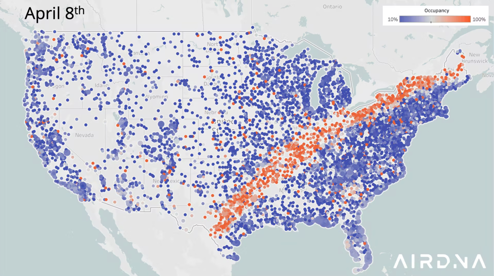
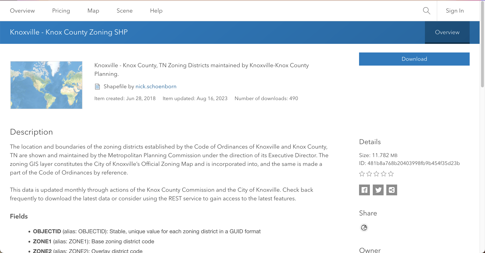
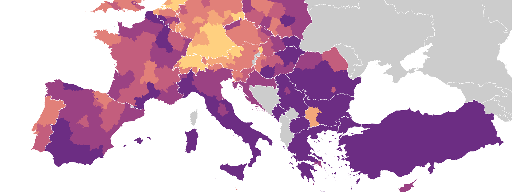
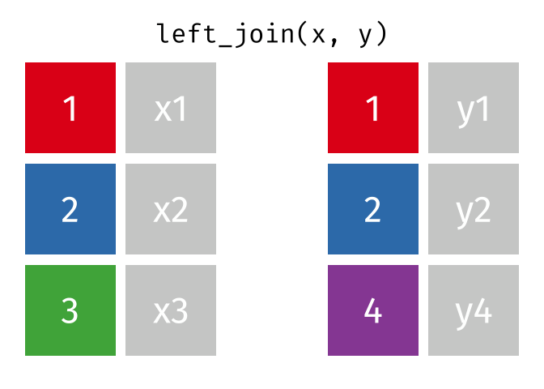

```{r setup, include=FALSE}
##NOTE TO SELF: NEED TO ACTUALLY USE {here} so I don't have to edit the file paths when running each chunk to include "week-13" and then take them out to knit. So annoying.

library(tidyverse)
```


# Weekly Check In/ <br>Download `.zip`

# Start Recording

## Today's Agenda
<hr>

:::{.smaller-font}
- Weekly Check In
- Foundational Ideas
- Vector spatial data and {sf}
- Finding geometries/shapefiles: tigris and `st_read()`
- Two Use Cases 
  - Plotting points
  - Creating choropleth maps
- Collaborative Practice
- Looking Ahead
:::

## Norms
<hr>

:::{.compact-font}
| In person norms | And also, for online learning... |
|----------|----------|
| Be fully present to each other & the work. | Keep your video on when possible. In large groups, mute your microphone when not talking. Close/mute/minimize other apps and devices to avoid distraction. |
| Assume positive intent & also take responsibility for the impact you have. | Remember online interaction masks even more of the full story. Notice when you are making assumptions, and seek information to check them. |
| Embrace collaboration. | Use the gallery view so you can see everyone. Use breakout groups as an opportunity to collaborate. |
| Be open to learning and accept non-closure. | Expect the inevitable technical glitches and learning curves. Exercise patience with one another. |
| Be aware of when to step up and step back. When stepping back, do so as an active listener. | Try out different modes of participation. Step back by making space for others to engage in these. |
| Land your plane--get to the point you intended. | We all know how hard it is to be talked at, especially in a Zoom session, so let's keep it to a minimum. |

:::

## Foundational Ideas
<hr>
 - Feedback on Mini-Project #2
 - YAML Headers

## Visualizing data with maps
<hr>
In addition to being fun and creative, cartography also has important practical applications. A carefully crafted map can be the best way of visualizing data.

```{r}
#| echo: false
#| out.width: 60%
#| fig-align: center

```

# Vector spatial data and {sf}

## The {sf} package {.smaller}
<hr>
- Maps in R are usually stored as **simple features** (sf): points, lines, and polygons
- The {sf} package lets us work with them. An sf object is **just a data frame with a `geometry` column**
- [{sf} cheat sheet](https://github.com/rstudio/cheatsheets/blob/main/sf.pdf)

```{r}
#install.packages("sf")
library(sf)

# Shapefile of 100 NC counties (comes with {sf})
nc_sf <- st_read(system.file("shape/nc.shp", package = "sf"), quiet = TRUE)
```

## The {sf} package {.smaller}
<hr>
- Looks like a regular data frame: one row per county...
- ...plus a `geometry` column holding each county's shape

```{r}
nc_sf |>
  select(NAME, AREA, geometry) |>
  head()
```

## `geom_sf()`
<hr>
- `geom_sf()` is a {ggplot2} geom for drawing sf objects
- It figures out the geometry type (points, lines, polygons) for you

```{r}
ggplot() +
  geom_sf(data = nc_sf) +
  theme_void() #removes bg, grids, axes, etc.
```

## Specifying the aesthetics{.smaller}
<hr>
Since it is a ggplot2 object, we can set aesthetics as usual, like `fill` and `color`:

```{r}
ggplot() +
  geom_sf(data = nc_sf, fill = "#0C1337", color = "white") +
  theme_void()
```

# Finding shapes

## Finding shapes {.smaller}
<hr>
- The `nc` data came with {sf}, but usually you'll need to find the shapes you want to map
  - e.g., to color in Tennessee counties, you need the boundaries of each county
- Two easy ways to get them:
  1. **A package** that downloads them for you, like {tigris}
  2. **A shapefile** you download and read in with `st_read()`

## The {tigris} package{.smaller}
<hr>
- {tigris} downloads shapes from the US Census Bureau: `states()`, `counties()`, `school_districts()`, `roads()`, and more
  - See all the functions: <https://github.com/walkerke/tigris>

```{r, results = "hide"}
#install.packages("tigris")
library(tigris)

tn_counties_sf <- counties(state = "TN")
```

```{r}
#| fig-height: 3
ggplot() +
  geom_sf(data = tn_counties_sf, color = "#993414", fill = "#FFFFFF") +
  theme_void()
```

## The {tigris} package{.smaller}
<hr>
What about the whole US?

```{r, results = "hide"}
us_states_sf <- states(cb = TRUE, resolution = "20m") |>
  filter(STUSPS != "PR") # drop Puerto Rico
```

```{r}
#| fig-height: 3.5
ggplot() +
  geom_sf(data = us_states_sf, color = "#993414", fill = "#FFFFFF") +
  theme_void()
```
YUCK! Alaska and Hawaii are far away.

## `shift_geometry()`{.smaller}
<hr>
- `shift_geometry()` (also from {tigris}) moves Alaska and Hawaii under the lower 48

```{r}
us_states_sf <- us_states_sf |>
  shift_geometry()

ggplot() +
  geom_sf(data = us_states_sf, color = "#993414", fill = "#FFFFFF") +
  theme_void()
```

## Labeling maps{.smaller}
<hr>

:::{.extra-small-font}
- `geom_sf_label()` (from {ggplot2}) puts a label in the middle of each shape, but small shapes can overlap
- `geom_label_repel()` from {ggrepel} (remember Week 10?) moves the labels apart. Add `stat = "sf_coordinates"` so it can find each shape's location
:::

```{r}
#| echo: false
library(ggrepel)
ne_states_sf <- us_states_sf |>
  filter(STUSPS %in% c("ME", "NH", "VT", "MA", "RI", "CT", "NY", "NJ", "PA", "DE", "MD"))
```

:::{.columns}
:::{.column width="50%"}

**geom_sf_label()**
```{r}
#| fig-height: 4.5
ggplot() +
  geom_sf(data = ne_states_sf, fill = "#FFFFFF", color = "#993414") +
  geom_sf_label(data = ne_states_sf, aes(label = NAME), size = 3) +
  theme_void()
```
:::
:::{.column width="50%"}

**geom_label_repel()**
```{r}
#| fig-height: 4.5
ggplot() +
  geom_sf(data = ne_states_sf, fill = "#FFFFFF", color = "#993414") +
  geom_label_repel(data = ne_states_sf, aes(label = NAME, geometry = geometry),
                   stat = "sf_coordinates", size = 3, seed = 1) +
  theme_void()
```
:::
:::

## Where to find shapefiles{.smaller}
<hr>
- Lots of agencies and organizations share shapefiles for free, including [Knox County](https://knoxplanning.org/data#tab_opendata):

:::{layout="[1,1]"}

:::{column}
- [IPUMS](https://international.ipums.org/international/gis.shtml)
- [GADM](https://gadm.org/)
- [Natural Earth](https://www.naturalearthdata.com/downloads/)
- [Eurostat](https://ec.europa.eu/eurostat/web/gisco/geodata)
- [OpenDataSoft](https://public.opendatasoft.com/explore/dataset/world-administrative-boundaries/table/?location=2,42.07882,0.00845&basemap=jawg.light)
:::

:::{column}
- [Free GIS Data](https://freegisdata.rtwilson.com/)
- [Geofabrik/OSM Data](https://download.geofabrik.de/)
- [U.S. Census Bureau](https://www.census.gov/geographies/mapping-files/time-series/geo/carto-boundary-file.html)
- [SimpleMaps](https://simplemaps.com/data/world-cities)
- [NCES](https://nces.ed.gov/programs/edge/Geographic/DistrictBoundaries)
:::

:::

## Reading shapefiles{.smaller}
<hr>
- A shapefile usually downloads as a `.zip` folder. Unzip it, but keep all the files together
- Let's map the [Knox County Zoning districts](https://www.arcgis.com/home/item.html?id=481b8a768b20403998fb9b454f35d23b). I unzipped it into a folder called `shapefiles`

```{r}
#| echo: false
#| out.width: 50%
#| fig-align: center

```

## Reading shapefiles{.smaller}
<hr>
Use `st_read()` (spatial functions in {sf} start with `st_`):

- `dsn`: the path to the shapefile folder
- `layer`: name of the shapefile

```{r}
knox_zones_sf <-
    st_read(dsn = "shapefiles",
            layer = "Knoxville-Knox_County_Zoning")
```

::: {.callout-tip}
I like to add `_sf` to the names of spatial objects so I remember they aren't regular data frames.
:::

# Two Applications/Cases

# #1: Adding Our Own<br>Data/Points (.csv)<br>to Map

## Plotting the shapefile {.smaller}
<hr>
```{r}
# Step 1: Plot the shapefile
ggplot() +
  geom_sf(data = knox_zones_sf)
```

## Adding our data as `.csv` {.smaller}
<hr>
```{r}
# Step 2: Read in the data for the points (lat/long)
knox_sites <- read_csv("KnoxSites.csv")

knox_sites
```

## A quick word on CRS {.smaller}
<hr>

:::{.extra-small-font}
- Every map has a **coordinate reference system (CRS)**: the rules for turning a round Earth into a flat map
- Each CRS has an **EPSG code**. Look them up at [spatialreference.org](https://spatialreference.org/ref/epsg/)
- Shapefiles and {tigris} data come with their CRS built in, but a `.csv` of lat/long is just numbers, so we have to tell R its CRS
- Plain latitude/longitude data uses EPSG **4326**. That's the only code you need to remember!
:::

:::{.columns}
:::{.column}
```{r}
#| echo: false
library(rnaturalearth) #Easy world map
world_sf <- ne_countries(scale = "medium", returnclass = "sf")

ggplot(world_sf) +
  geom_sf() +
  ggtitle("Lat/long (CRS 4326)")
```
:::
:::{.column}
```{r}
#| echo: false
ggplot(st_transform(world_sf, crs = "+proj=moll")) +
  geom_sf() +
  ggtitle("Projected (Mollweide)")
```
:::
:::

## Converting our data to sf object {.smaller}
<hr>
- `st_as_sf()` turns a data frame with lat/long columns into an sf object
```{r}
# Step 3: Convert the point data to an sf object
knox_sites_sf <- st_as_sf(knox_sites,
                          coords = c("Longitude", "Latitude"), crs = 4326)

class(knox_sites_sf)
```

## Checking the CRS {.smaller}
<hr>
- `st_crs()` tells us an sf object's CRS. Add `$epsg` to get just the EPSG code

```{r}
st_crs(knox_sites_sf)$epsg # we set this with st_as_sf()

st_crs(knox_zones_sf)$epsg # came built into the shapefile
```

- [2915](https://spatialreference.org/ref/epsg/2915/) is a projected CRS designed for Tennessee (measured in feet, not degrees)
- Our points and our zones use **different** CRSs!

## Why does the CRS matter? {.smaller}
<hr>

:::{.extra-small-font}
- The **same** Knox County zones in two CRSs: <span style="color:#58595B">**gray = EPSG 2915 (feet)**</span>, <span style="color:#FF8200">**orange = EPSG 4326 (degrees)**</span>
- Under the hood, coordinates are just numbers, and these are in different units. Plotted as raw numbers, the same place lands in two very different spots
:::

```{r}
#| echo: false
#| fig-height: 3.5
zones_2915 <- st_set_crs(knox_zones_sf, NA) # strip the CRS: just numbers
zones_4326 <- knox_zones_sf |> st_transform(4326) |> st_set_crs(NA)

ggplot() +
  geom_sf(data = zones_2915, fill = "#58595B", color = NA) +
  geom_sf(data = zones_4326, fill = "#FF8200", color = "#FF8200", linewidth = 2) +
  annotate("label", x = 320000, y = 150000, size = 5, hjust = 0,
           label = "The 4326 version is down here!\n(it's less than 1 unit wide)") +
  annotate("segment", x = 310000, y = 120000, xend = 30000, yend = 10000,
           arrow = arrow(length = unit(0.3, "cm"))) +
  annotate("label", x = 2420000, y = 610000, size = 5, hjust = 1,
           label = "The 2915 version") +
  scale_x_continuous(labels = scales::label_comma()) +
  scale_y_continuous(labels = scales::label_comma()) +
  labs(x = NULL, y = NULL)
```

## Plotting our data {.smaller}
<hr>

:::{.extra-small-font}
- The zoning shapefile (2915) uses a different CRS than our points (4326). Can we still plot them together?
- Yes! `geom_sf()` converts the layers so they line up ("projecting on the fly")
:::

```{r}
# Step 4: Add the points sf object as a new geom_sf() layer
ggplot() +
  geom_sf(data = knox_zones_sf) +
  geom_sf(data = knox_sites_sf, fill = "#FF8200", color = "#000", linewidth = 1, size = 3, shape = 21)
```

# #2: Choropleth Maps

## Choropleth maps
<hr>
Geographical heat maps, also known as choropleth maps, color each area by a value in our data.

```{r}
#| echo: false
#| out.width: 60%
#| fig-align: center

```

## Joining data to shapes {.smaller}
<hr>
- Our shapes and our data are usually in separate tables, so we need to **join** them
- We need a shared ID. For US places, that's usually the **FIPS** code
  - The Federal Information Processing Standards (FIPS) have codes for [states, counties](https://transition.fcc.gov/oet/info/maps/census/fips/fips.txt), etc.

```{r}
#| echo: false
#| out.width: 60%
#| fig-align: center

```

## Introducing `left_join()` {.smaller}
<hr>

:::{.extra-small-font}
- `left_join(x, y, by = "key")` combines two data frames by matching rows on a shared **key** variable
  - Keeps **every row of `x`** (the "left" table) and adds the columns from `y`
  - If a row in `x` has no match in `y`, the new columns get `NA`
:::

:::{.columns}
:::{.column width="50%"}
States
```{r, echo=F}
states <- tibble(
  fips  = c("47", "01", "13"),
  state = c("Tennessee", "Alabama", "Georgia"))

states
```

Pops
```{r, echo=F}
pops <- tibble(
  fips  = c("47", "01", "37"),
  state = c("Tennessee", "Alabama", "North Carolina"),
  pop   = c(6.9, 5.0, 10.4))

pops
```
:::
:::{.column width="50%"}
```{r}
left_join(states, pops, by = "fips")
```

:::{.extra-small-font}
- Georgia (`"13"`) isn't in `pops` → `NA`
- North Carolina (`"37"`) isn't in `states` → dropped
- Both tables have a `state` column, but we only joined `by = "fips"` → R keeps both and adds suffixes: `state.x` (from `states`) and `state.y` (from `pops`)
:::
:::
:::

## Our data {.smaller}
<hr>

:::{.extra-small-font}
:::{.columns}
:::{.column width="50%"}
Our shapes (from {tigris}):

```{r}
us_states_sf |>
  select(STATEFP, NAME) |>
  head(4)
```
:::
:::{.column width="50%"}
2020 Census population by state:

```{r}
# Step 1: Load in your data
# (keep GEOID as text so "01" doesn't become 1!)
pop_counts_2020 <- read_csv("state_pop_2020.csv",
                            col_types = cols(GEOID = "c"))

head(pop_counts_2020, 4)
```
:::
:::
:::

:::aside
Pulled with [{tidycensus}](https://walker-data.com/tidycensus/) (needs a free API key): `get_decennial(geography = "state", variables = "DP1_0001C", year = 2020, sumfile = "dp")`
:::

## Joining the data {.smaller}
<hr>

:::{.extra-small-font}
- Both tables have the state FIPS code, but with different names: `STATEFP` in `us_states_sf` and `GEOID` in `pop_counts_2020`
- **Put the sf object first** so the result is still an sf object
:::

```{r}
# Step 2: Left join using the FIPS codes
joined_state_data_sf <- left_join(us_states_sf, pop_counts_2020,
                                  by = c("STATEFP" = "GEOID"))

joined_state_data_sf |>
  select(STATEFP, NAME.x, NAME.y, value) |>
  head(3)
```

## Plotting spatial data{.smaller}
<hr>
- Map the data to `fill` inside `aes()`

```{r}
# Step 3: Plot using the joined data
ggplot() +
  geom_sf(data = joined_state_data_sf, aes(fill = value)) +
  scale_fill_viridis_c(option = "magma", labels = scales::label_comma(), direction = -1) +
  theme_void()
```

## Adding points{.smaller}
<hr>
- Same steps as Case #1: read in the `.csv`, `st_as_sf()`, add a `geom_sf()` layer
- `shift_geometry()` moves the Alaska and Hawaii capitals to match the shifted map

```{r}
# Step 4: Read in the capitals and convert to sf
state_capitals_sf <- read_csv("us-state-capitals.csv") |>
  st_as_sf(coords = c("longitude", "latitude"), crs = 4326) |>
  shift_geometry()

# Step 5: Add the capitals as another geom_sf() layer
capitals_map <- ggplot() +
  geom_sf(data = joined_state_data_sf, aes(fill = value)) +
  geom_sf(data = state_capitals_sf, shape = 8, color = "limegreen") +
  scale_fill_viridis_c(option = "magma", labels = scales::label_comma(), direction = -1) +
  theme_void()
```

## Adding points{.smaller}
<hr>
```{r}
capitals_map
```


## Next Semester (Pt. I) {.smaller}
<hr>

- **STEM 692:** Applied Machine Learning in Education, Health, and Human Sciences (Online, Sync)
  - Wed: 9-11am
  - Dr. Joshua Rosenberg

- **CADE 691:** Visualizing Data in R (Online, Sync)
  - Thurs: 3-5pm
  - Dr. Joshua Rosenberg

- **CADE 695:** Capstone in Educational Data Science (Online, Async)
  - Date/Time: TBD based on student/faculty schedules
  - Dr. Joshua Rosenberg

## Grad certificate
<hr>
The University of Tennessee, Knoxville, offers an online graduate certificate in Educational Data Science for students interested in digital data collection, analysis, visualization, and more in educational settings. The certificate can be added to current graduate students’ studies or pursued as a stand-alone certificate for graduate-level students.

- [More Info](https://volsonline.utk.edu/program/certificates/educational-data-science/)
- [Apply Here](https://gradschool.utk.edu/academics/forms-central/admission-to-a-graduate-certificate-program/)

# Looking Ahead

## Next Week's Structure {.smaller}
<hr>
- Test drive zoom timers
- [Final rubric](https://docs.google.com/document/d/14JZKwX3227a4LdiqJDmWEkiaRZvlHGfQg6JUvqLaLNc/edit?usp=sharing) (incorporating your suggestions)
- Preview peer feedback form
  - [Section A](https://airtable.com/appxk3cJS5Wp4CYK4/shrNo1yJwUrKLYtPl)
  - [Section B](https://airtable.com/appBVRcTY7OGYJROm/shrHYges8GlncbhPN)
  - Praise
  - Question
  - Polish
  
## Looking Ahead {.smaller}
<hr>
- Next week:
  - Final Project Presentations!
  - 5 min presentation of your final project
    - 1 overview slide, 3 plots
- Homework:
  - Complete slides in shared Google Slides by Monday night (see Final Project Assignment)
  - Final project Canvas submissions due 12/4, 11:59pm
    - Remember to explicitly state your research question for each viz
    - Define each variable used and how measured/units
    - Preview your .html before submitting. It should like a finished, polished report!
    - No late finals accepted.

# Collaborative Practice