# Weekly Check In/ <br>Download `.zip`

# Start Recording

## Today's Agenda
<hr>

:::{.smaller-font}
- **Weekly Check In**
- **Foundational Skills**
    - CRAN vs. {remotes}
- **Themes**
    - Pre-Built
    - Packages
    - Custom
- **Color**
    - Built-in Color
    - Color Palettes
    - Accessibility
- **Collaborative Practice**
- **Looking Ahead**
:::

## Norms
<hr>

:::{.compact-font}
| In person norms | And also, for online learning... |
|----------|----------|
| Be fully present to each other & the work. | Keep your video on when possible. In large groups, mute your microphone when not talking. Close/mute/minimize other apps and devices to avoid distraction. |
| Assume positive intent & also take responsibility for the impact you have. | Remember online interaction masks even more of the full story. Notice when you are making assumptions, and seek information to check them. |
| Embrace collaboration. | Use the gallery view so you can see everyone. Use breakout groups as an opportunity to collaborate. |
| Be open to learning and accept non-closure. | Expect the inevitable technical glitches and learning curves. Exercise patience with one another. |
| Be aware of when to step up and step back. When stepping back, do so as an active listener. | Try out different modes of participation. Step back by making space for others to engage in these. |
| Land your plane--get to the point you intended. | We all know how hard it is to be talked at, especially in a Zoom session, so let's keep it to a minimum. |

:::

# Review/ <br>Foundational Skills

<!-- ## Cleaning the data {.smaller}
<hr>
- Let's talk a bit about cleaning data
  - Some cleaning steps we would do at first to "clean up" the dataset
    - Remove the erroneous values in `public_private'
    - Separate the `sat_act` variables into separate variables (different ways to do this)
    - Remove the meaningless rows (e.g. extra rows in middle of the dataset)
  - We would not want to `filter(!is.na(x))` for every variable at the beginning of the analysis (or use other code that does the same thing, like `complete.cases()`)

  ***WHY?*** -->

## CRAN & install.packages()
<hr>

:::{.smaller-font .tight-lines}
- Most packages are downloadable from CRAN
  - "Comprehensive R Archive Network"
  - Hosts thousands of packages
    - Quality checks
    - Version control

:::

:::{layout="[1,1]" .smaller-font}
:::{column}
- {tidyverse} is on CRAN
- {remotes} is also a package on CRAN

```{r}
#install.packages("tidyverse")
library(tidyverse)

#install.packages("remotes")
library(remotes)
```

:::

:::

## {remotes} & install_*()
<hr>
:::{.smaller-font}

- Not all packages are downloadable from CRAN
- {remotes} helps us install the ones that aren't 
:::

```{r}
#remotes::install_github("tidyverse/dsbox")
library(dsbox)
```

:::{.smaller-font}
- {dsbox} is not on CRAN but is downloadable from GitHub
- We will use the `install_github()` function from {remotes} to install {dsbox}
:::

## New data today = AAUP
<hr>

:::{.smaller-font}
The American Association of University Professors (AAUP) is a nonprofit
membership association of faculty and other academic professionals. This report
compiled by the AAUP shows trends in instructional staff as a percentage of 
employees between 1975 and 2011.
:::

```{r, echo=F}
staff_long <- instructors |>
  pivot_longer(
    cols = !year, # "Which columns do I pivot?"
    names_to = "position", # "What should I call the new column that holds the old column names?"
    values_to = "percentage" # "What should I call the new column that holds the old values?"
  )
head(staff_long, 10)
```

<!-- 
::::{.fragment .extra-small-font}
```{r, echo=F}
library(knitr) #ignore this -> just doing it for the kable to print all cols
instructors <- instructors #in dsbox, assigning so it shows in environment
kable(instructors)
```
::::

# tidy data + `pivot_longer()`

## tidy data
<hr>

#### Requirements for tidy data

::: {.smaller-font}
1. Each variable forms a column
2. Each observation forms a row
3. Each value forms a cell (1 cell: 1 value)

    - If you can split it, split it!

        - City, State
        - ACT/SAT
        - 26 inches (value + unit)
:::

## tidy data
<hr>

```{=html}
<style>
  .tidy-toggle { font-size: 0.5em; line-height: 1.4; text-align: left; }
  .tidy-toggle .tt-row { display: flex; flex-wrap: wrap; align-items: center; gap: 8px; margin-bottom: 10px; }
  .tidy-toggle .tt-label { opacity: 0.7; margin-right: 6px; }
  .tidy-toggle button {
    font: inherit; color: inherit; background: transparent; cursor: pointer;
    border: 1px solid rgba(128,128,128,0.5); border-radius: 6px; padding: 4px 12px;
  }
  .tidy-toggle button:hover { background: rgba(128,128,128,0.15); }
  .tidy-toggle button.on { background: rgba(128,128,128,0.25); border-color: rgba(128,128,128,0.9); font-weight: 600; }
  .reveal .tidy-toggle table { width: 100%; margin: 0 0 12px 0; border-collapse: collapse; table-layout: fixed; }
  .reveal .tidy-toggle table th,
  .reveal .tidy-toggle table td {
    padding: 6px 10px; text-align: left; font-family: monospace;
    border: 1px solid rgba(128,128,128,0.45); transition: background 0.15s;
  }
  .reveal .tidy-toggle table th { font-weight: 600; background: rgba(128,128,128,0.12); }
  .tidy-toggle .h1 { background: rgba(55,138,221,0.35) !important; }
  .tidy-toggle .h2 { background: rgba(239,159,39,0.40) !important; }
  .tidy-toggle .h3 { background: rgba(99,153,34,0.40)  !important; }
  .tidy-toggle .tt-cap {
    display: flex; gap: 10px; align-items: flex-start; padding: 10px 14px;
    border-radius: 6px; background: rgba(128,128,128,0.12); min-height: 3.2em;
  }
  .tidy-toggle .tt-icon { font-weight: 700; font-size: 1.3em; line-height: 1; }
  .tidy-toggle .tt-icon.bad  { color: #d9534f; }
  .tidy-toggle .tt-icon.good { color: #3c9a3c; }
</style>

<div class="tidy-toggle">
  <div class="tt-row">
    <span class="tt-label">Table</span>
    <button data-mode="wide">Wide</button>
    <button data-mode="long">Long</button>
  </div>
  <div class="tt-row">
    <span class="tt-label">Check rule</span>
    <button data-rule="1">1 · Variables are columns</button>
    <button data-rule="2">2 · Observations are rows</button>
    <button data-rule="3">3 · Values are cells</button>
  </div>
  <div class="tt-table"></div>
  <div class="tt-cap"><span class="tt-icon"></span><span class="tt-text"></span></div>
</div>

<script>
(function () {
  var years = [1975, 1989];
  var pos = ['full_time_tenured', 'part_time', 'grad_student'];
  var vals = { 1975: [29.0, 24.0, 20.5], 1989: [27.6, 30.4, 16.5] };

  var caps = {
    wide: {
      1: [false, 'The column names full_time_tenured, part_time, and grad_student are values of one variable (position). Position is a variable, but it has no column of its own.'],
      2: [false, 'This one row holds three observations: tenured, part-time, and grad students, all in 1975. Each observation should get its own row.'],
      3: [false, 'Percentage is a single variable, but its values are spread across three columns instead of living in one.']
    },
    long: {
      1: [true, 'Three variables, three columns: year, position, and percentage.'],
      2: [true, 'One row, one observation: the share of part-time instructors in 1975. The next row is a different observation.'],
      3: [true, 'Every percentage sits in a single column, one value per cell.']
    }
  };

  function cell(tag, txt, cls) {
    return '<' + tag + (cls ? ' class="' + cls + '"' : '') + '>' + txt + '</' + tag + '>';
  }

  function init(root) {
    var mode = 'wide', rule = null;

    function render() {
      var T = 'ta' + 'ble';
      var c = rule ? 'h' + rule : '', h = '<' + T + '>';

      if (mode === 'wide') {
        h += '<tr>' + cell('th', 'year', '');
        pos.forEach(function (p) { h += cell('th', p, rule === 1 ? c : ''); });
        h += '</tr>';
        years.forEach(function (y, i) {
          var rowOn = rule === 2 && i === 0;
          h += '<tr>' + cell('td', y, rowOn ? c : '');
          vals[y].forEach(function (v) {
            h += cell('td', v.toFixed(1), (rowOn || rule === 3) ? c : '');
          });
          h += '</tr>';
        });
      } else {
        h += '<tr>';
        ['year', 'position', 'percentage'].forEach(function (t) {
          h += cell('th', t, rule === 1 ? c : '');
        });
        h += '</tr>';
        var n = 0;
        years.forEach(function (y) {
          pos.forEach(function (p, j) {
            var rowOn = rule === 2 && n === 1;
            h += '<tr>' + cell('td', y, rowOn ? c : '') +
                 cell('td', p, rowOn ? c : '') +
                 cell('td', vals[y][j].toFixed(1), (rowOn || rule === 3) ? c : '') + '</tr>';
            n++;
          });
        });
      }
      h += '</' + T + '>';
      root.querySelector('.tt-table').innerHTML = h;

      var icon = root.querySelector('.tt-icon');
      if (rule === null) {
        icon.textContent = '';
        icon.className = 'tt-icon';
        root.querySelector('.tt-text').textContent = '';
      } else {
        var cp = caps[mode][rule];
        icon.textContent = cp[0] ? '\u2713' : '\u2717';
        icon.className = 'tt-icon ' + (cp[0] ? 'good' : 'bad');
        root.querySelector('.tt-text').textContent = cp[1];
      }

      root.querySelectorAll('[data-mode]').forEach(function (b) {
        b.classList.toggle('on', b.dataset.mode === mode);
      });
      root.querySelectorAll('[data-rule]').forEach(function (b) {
        b.classList.toggle('on', Number(b.dataset.rule) === rule);
      });
    }

    root.querySelectorAll('[data-mode]').forEach(function (b) {
      b.addEventListener('click', function () { mode = b.dataset.mode; render(); });
    });
    root.querySelectorAll('[data-rule]').forEach(function (b) {
      b.addEventListener('click', function () {
        var n = Number(b.dataset.rule);
        rule = (rule === n) ? null : n;   // click again to deselect
        render();
      });
    });
    render();
  }

  document.querySelectorAll('.tidy-toggle').forEach(init);
})();
</script>
```

:::{.extra-small-font}
Wickham, H. (2014). Tidy data. Journal of Statistical Software, 59(10), 1-23. https://doi.org/10.18637/jss.v059.i10
:::

<!-- ## tidy data & `pivot_longer`
<hr>

:::{.smaller-font}
**Requirements for tidy data:**

1. Each variable forms a column
2. Each observation forms a row
3. Each value forms a cell

::::{.fragment}

**Question**: Is this data in tidy format? Why or why not?
:::
::::

::::{.fragment .extra-small-font}
```{r, echo=F}
kable(head(instructors, 5))
```
::::

## tidy data & `pivot_longer`
<hr>

:::{.smaller-font}
**Requirements for tidy data:**

1. Each variable forms a column
2. Each observation forms a row
3. Each value forms a cell

::::{.fragment}

**Answer**: No:

- *Violates #1*. The column names (except year) are position types, which should be values in a column.
- *Violates #2*. Each row has multiple observations for that year.
- *Violates #3*. The same value types (percentages of whole workforce) are spread across multiple columns.
:::
::::

::::{.fragment}
**Let's tidy**
:::: -->
<!-- 
# tidying the data

## `pivot_longer` {.smaller}
<hr>

- Long data (tidy data) is often preferred, esp. in {tidyverse}
- `pivot_longer()` is your friend
  - See documentation [here](https://tidyr.tidyverse.org/reference/pivot_longer.html)
  - Inverse operation of `pivot_wider()`

## `pivot_wider` (recap) {.smaller}
<hr>
- Last week!

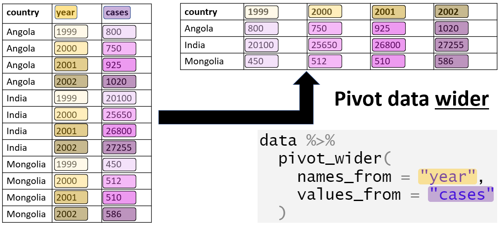

:::{.extra-small-font}
Batra, Neal, et al. (2021). *The Epidemiologist R Handbook*. www.epirhandbook.com/en/
:::

## `pivot_longer` {.smaller}
<hr>

- Long data (tidy data) is often preferred, esp. in {tidyverse}
- `pivot_longer()` is your friend
  - See documentation [here](https://tidyr.tidyverse.org/reference/pivot_longer.html)
  - Inverse operation of `pivot_wider()`

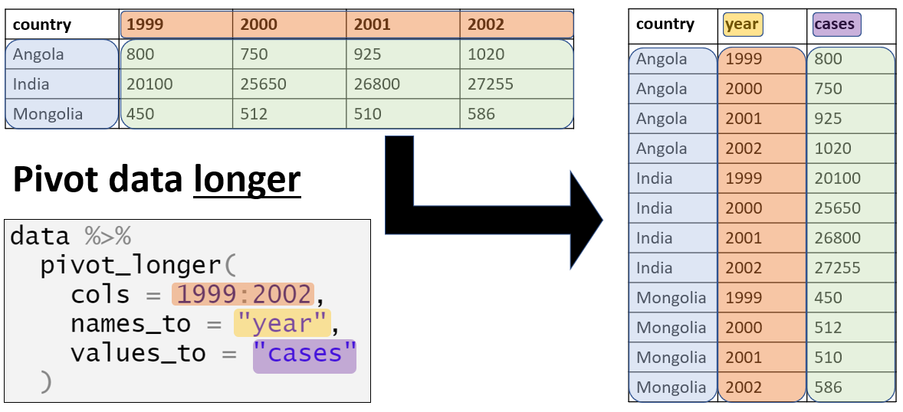

:::{.extra-small-font}
Batra, Neal, et al. (2021). *The Epidemiologist R Handbook*. www.epirhandbook.com/en/
:::


## tidy data & `pivot_longer`
<hr>

:::{.smaller-font .tight-lines}
**Requirements for tidy data:**

1. Each variable forms a column
2. Each observation forms a row
3. Each value forms a cell
:::

::: {.fragment .smaller-font}
```{r}
head(instructors, 5)
```

::::{.fragment}
`pivot_longer()`
::::
:::

::::{.fragment .smaller-font}
```{r, eval=F}
staff_long <- instructors |>
  pivot_longer(
    cols = !year, # "Which columns do I pivot?"
    names_to = "position", # "What should I call the new column that holds the old column names?"
    values_to = "percentage" # "What should I call the new column that holds the old values?"
  )
```
::::


## tidy data & `pivot_longer`
<hr>

:::{.smaller-font .tight-lines}
**Requirements for tidy data:**

1. Each variable forms a column
2. Each observation forms a row
3. Each value forms a cell

::::{.fragment}

`pivot_longer()`
:::
::::

::::{.fragment .smaller-font}
```{r}
staff_long <- instructors |>
  pivot_longer(
    cols = !year, # "Which columns do I pivot?"
    names_to = "position", # "What should I call the new column that holds the old column names?"
    values_to = "percentage" # "What should I call the new column that holds the old values?"
  )
head(staff_long, 10)
```
::::
 -->


# Review: Line Plots

## Review: Line Plots {.smaller}
<hr>
- **Note:** I am storing this plot to `p`
```{r}
p <- staff_long |>
  ggplot(aes(x = year, y = percentage, color = position, group = position)) +
  geom_line(linewidth = 2) #Note: color argument should implicitly handle grouping

p
```

## Recall {ggplot2} Components
<hr>

Plots made with {ggplot2} are made of numerous components.

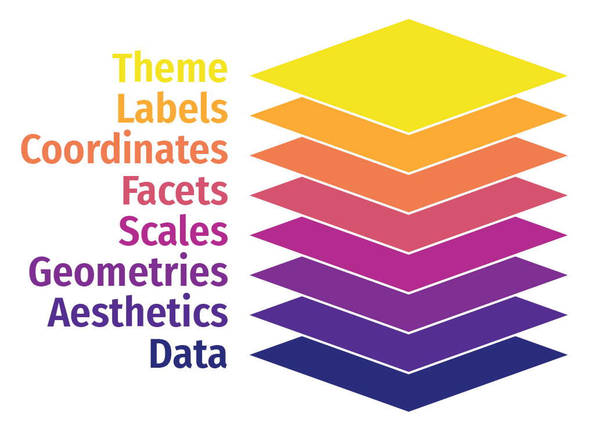{fig-align="center"}


## Recall {ggplot2} Layers
<hr>
Today, we'll be focusing on `theme()`.

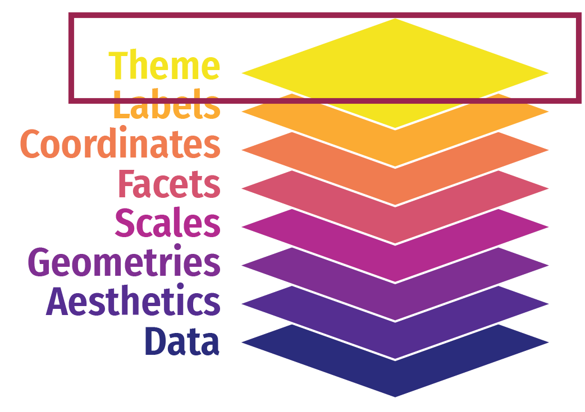{fig-align="center"}


# Data-to-Ink Ratios

## Suggestion from Tufte
<hr>

:::{.smaller-font}
- Edward Tufte, a statistician and professor emeritus at Yale University, is known for his work in data viz.
- Tufte suggests that the data should be the "star of the show" in a visualization --> the data-ink ratio should be high
:::

**What does this mean?**
<br><br>
<center>

:::{.fragment}
$\text{data-to-ink ratio} = \dfrac{\text{data ink}}{\text{total ink}}$
:::
</center>
<br>

:::{.fragment .smaller-font .tight-lines}
Think again about the necessity of all the non-data components of your plot - e.g., your theme!
:::

## Themes and non-data ink
<hr>

:::{.smaller-font}
The 'theme' involves editing the content that supports the data but does not deliver the quantitative information itself: background, grid lines, ticks, labels, legends, etc. -- "non-data ink".
:::

:::{layout="[1,1]"}
::: {column}

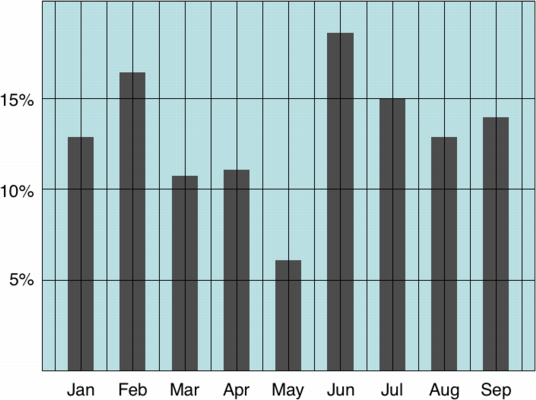
:::

::: {column}
:::

::::

## Themes and non-data ink
<hr>
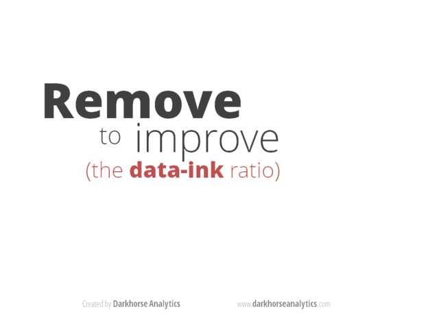{fig-align="center"}

:::aside
This is all subjective!... Avoid "chartjunk!"
:::

# Themes

## Pre-Built Themes
<hr>

:::{.smaller-font}
- {ggplot2} already has [several themes](https://ggplot2.tidyverse.org/reference/ggtheme.html) built in
- You've used these already:
    - `theme_minimal()`
    - `theme_light()`
    - `theme_dark()`
    - `theme_bw()`
    - `theme_void()`
    - `theme_classic()`
    - `theme_linedraw()`
    - `theme_test()`
    - `theme_gray()`
:::

# Other Theme Packages

## Theme Packages - {ggthemes} {.smaller}
<hr>
[{ggthemes}](https://jrnold.github.io/ggthemes/reference/index.html)

```{r}
library(ggthemes)

p +
  theme_tufte()
```

## Theme Packages - {ggthemes} {.smaller}
<hr>
[{ggthemes}](https://jrnold.github.io/ggthemes/reference/index.html)

```{r}
library(ggthemes)

p +
  theme_solarized()
```

## Theme Packages - {ggthemes} {.smaller}
<hr>
[{ggthemes}](https://jrnold.github.io/ggthemes/reference/index.html)

```{r}
library(ggthemes)

p +
  theme_excel()
```

## Theme Packages - {pilot} {.smaller}
<hr>
[{pilot}](https://github.com/olihawkins/pilot)

:::{.extra-small-font .tight-lines}
- accessible, modern, for discrete data only (no gradients)
:::

```{r}
#remotes::install_github("olihawkins/pilot")
library(pilot)

p + theme_pilot()
```

## Theme Packages - {hrbrthemes} {.smaller}
<hr>
[{hrbrthemes}](https://github.com/hrbrmstr/hrbrthemes)

:::{.extra-small-font .tight-lines}
- modern, typography-centered, discrete & continuous
:::

```{r}
library(hrbrthemes)

p + theme_ipsum_rc() #ipsum is base theme, rc is font
```


# Custom Themes

## Custom Themes {.smaller}
<hr>
- Pre-built themes are just when someone has customized all the theme options for you

```{r}
theme_minimal()
```

## Custom Themes {.smaller}
<hr>
- You can create your theme settings in one .R script and copy/paste them into your current script.

```{r}
# store all your customizations to an object
my_theme <- theme(
  legend.position = "bottom",
  panel.background = element_rect(fill = "white")
)
# add that object to your ggplot
p + my_theme
```

<!-- ## `theme()` anatomy {.smaller auto-animate="true"}
<hr>
- Our starting plot for today
  - Note: I am storing it to an object `p` for later use -->

```{r, echo=F}
p <- staff_long |>
  ggplot(aes(x = year, y = percentage, color = position)) +
  geom_line(linewidth = 2) +
  labs(title = "Instructional staff employment trends")
```

## `theme()` anatomy {.smaller}
<hr>
Make the title 16 point and bold

```{r}
p +
  theme(
    plot.title = element_text(face = "bold", size = 16)
  )
```

## `theme()` anatomy {.smaller}
<hr>
Place legend on the bottom

```{r}
p +
  theme(
    plot.title = element_text(face = "bold", size = 16),
    legend.position = "bottom"
  )
```

## `theme()` anatomy {.smaller}
<hr>
Make the background white

```{r}
p +
  theme(
    plot.title = element_text(face = "bold", size = 16),
    legend.position = "bottom",
    panel.background = element_rect(fill = "white")
  )
```

## `theme()` Anatomy Reference Guide
<hr>
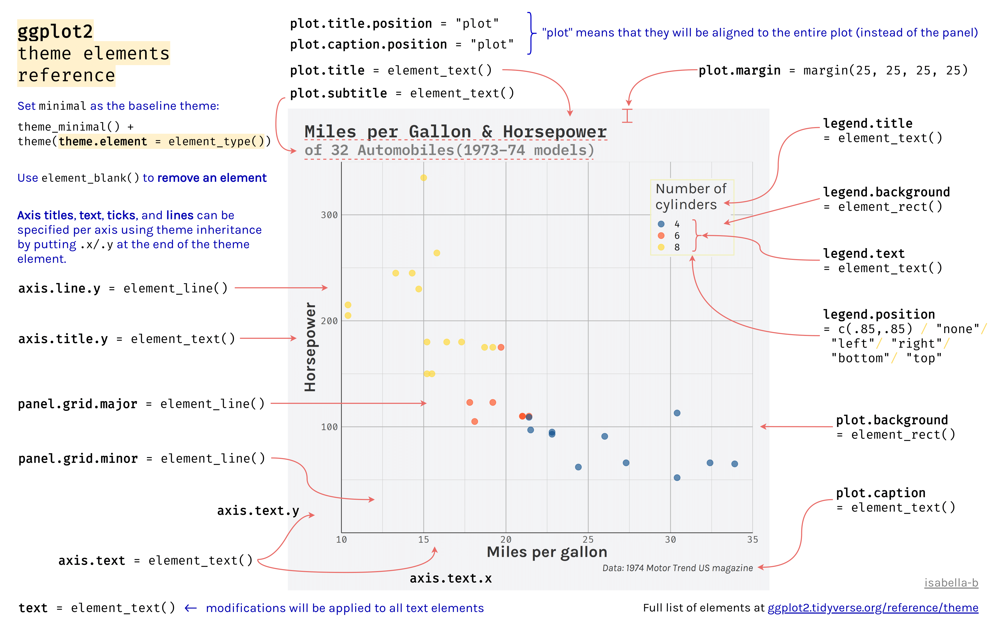{width=725px fig-align="center"}

::: aside
Source: [https://bookdown.org/alapo/learnr/data-visualisation.html](https://bookdown.org/alapo/learnr/data-visualisation.html)

Full list of elements available at [ggplot2.tidyverse.org/reference/theme](https://ggplot2.tidyverse.org/reference/theme)
:::

## Modifying theme components {.smaller}
<hr>

:::{layout="[1,2]"}
:::{.column .smaller-font .tight-lines}
**Four basic types** of built-in element functions:

* [`element_text()`](https://ggplot2.tidyverse.org/reference/element.html) draws labels and headings
* [`element_line()`](https://ggplot2.tidyverse.org/reference/element.html) draws lines by color, linewidth and linetype
* [`element_rect()`](https://ggplot2.tidyverse.org/reference/element.html) draws rectangles, mostly used for backgrounds
* [`element_blank()`](https://ggplot2.tidyverse.org/reference/element.html) draws nothing
:::
:::{.column}

```{r}
p +
  theme(
    plot.title = element_text(size = 70),
    panel.grid.major = element_line(color = "black"),
    plot.background = element_rect(color = "red", linewidth = 2),
    axis.title.x = element_blank()
  )
```

:::
:::

<!-- ## Modifying theme components {.smaller}
<hr>
Four basic types of built-in element functions:

* [`element_text()`](https://ggplot2.tidyverse.org/reference/element.html) draws labels and headings:

```{r}
p +
  theme(plot.title = element_text(size = 70))
```

## Modifying theme components {.smaller}
<hr>
Four basic types of built-in element functions:

* [`element_line()`](https://ggplot2.tidyverse.org/reference/element.html) draws lines by color, linewidth and linetype: 

```{r}
p +
  theme(panel.grid.major = element_line(color = "black"))
```

## Modifying theme components {.smaller}
<hr>
Four basic types of built-in element functions:

* [`element_rect()`](https://ggplot2.tidyverse.org/reference/element.html) draws rectangles, mostly used for backgrounds

```{r}
p +
  theme(plot.background = element_rect(color = "red", linewidth = 2))
```

## Modifying theme components {.smaller}
<hr>
Four basic types of built-in element functions:

* [`element_blank()`](https://ggplot2.tidyverse.org/reference/element.html) draws nothing

```{r}
p +
  theme(axis.title.x = element_blank())
```

## Modifying theme components {.smaller}
<hr>
Modify multiple theme components in the same `theme()`

```{r}
p +
  theme(
    plot.title = element_text(size = 70),
    panel.grid.major = element_line(color = "black"),
    plot.background = element_rect(color = "red", linewidth = 2),
    axis.title.x = element_blank()
  )
``` 
-->

## Modifying theme components {.smaller}
<hr>
Can also add on to an existing theme:

```{r}
#| code-line-numbers: |2
p +
  theme_minimal() +
  theme(
    plot.title = element_text(size = 70),
    panel.grid.major = element_line(colour = "black"),
    plot.background = element_rect(color = "red", linewidth = 2),
    axis.title.x = element_blank()
  )
```

. . .

What happens if you put `theme()` before `theme_minimal()`?

<!-- # BREAK -->

# Colors

## Built-in colors {.smaller}
<hr>
* R comes pre-loaded with [657 named colors](https://r-charts.com/colors/)
* You can also specify any color using a hex code (#RRGGBB)
* Use the `colors()` command to see the available named colors

```{r}
colors()
```

## Built-in colors
<hr>
Use the name of the color in quotes:

```{r}
#| code-line-numbers: "|3"
staff_long |>
  ggplot(aes(x = position, y = percentage)) +
  geom_col(fill = "royalblue")
```

<!-- . . .

What if you put `fill = "royalblue"` inside of `aes()`?

## Built-in colors
<hr>
Inside of `aes()`, `fill` maps to the data.

```{r}
#| code-line-numbers: "|2"
staff_long |>
  ggplot(aes(x = position, y = percentage, fill = "royalblue")) +
  geom_col()
``` 

-->

<!-- ## Built-in colors
<hr>
You can specify colors for specific values using `scale_fill_manual` and a named vector:

```{r}
#| eval: false
#| code-line-numbers: "|4-11|"
staff_long |>
  ggplot(aes(x = position, y = percentage)) +
  geom_col() +
  scale_fill_manual(
    values = c(
      "full_time_non_tenure_track" = "skyblue",
      "full_time_tenure_track" = "peachpuff1",
      "full_time_tenured" = "palegreen1",
      "grad_student" = "sandybrown",
      "part_time" = "maroon"
    )
  )
```

## Built-in colors {.smaller}
<hr>
You can specify colors for specific values using `scale_fill_manual` and a named vector:

```{r}
#| echo: false
#| error: true
#| eval: true
staff_long |>
  ggplot(aes(x = position, y = percentage)) +
  geom_col() +
  scale_fill_manual(
    values = c(
      "full_time_non_tenure_track" = "skyblue",
      "full_time_tenure_track" = "peachpuff1",
      "full_time_tenured" = "palegreen1",
      "grad_student" = "sandybrown",
      "part_time" = "maroon"
    )
  )
```

Why are there no colors? -->

## Built-in colors
<hr>
You can specify colors for specific values using `scale_fill_manual` and a named vector **as long as `fill` is mapped to the data**:

```{r}
#| eval: false
#| code-line-numbers: "|2,4-11"
staff_long |>
  ggplot(aes(x = position, y = percentage, fill = position)) +
  geom_col() +
  scale_fill_manual(
    values = c(
      "full_time_non_tenure_track" = "skyblue",
      "full_time_tenure_track" = "peachpuff1",
      "full_time_tenured" = "palegreen1",
      "grad_student" = "sandybrown",
      "part_time" = "maroon"
    )
  )
```

## Built-in colors
<hr>
You can specify colors for specific values using `scale_fill_manual` and a named vector **as long as `fill` is mapped to the data**:

```{r}
#| error: true
#| echo: false
staff_long |>
  ggplot(aes(x = position, y = percentage, fill = position)) +
  geom_col() +
  scale_fill_manual(
    values = c(
      "full_time_non_tenure_track" = "skyblue",
      "full_time_tenure_track" = "peachpuff1",
      "full_time_tenured" = "palegreen1",
      "grad_student" = "sandybrown",
      "part_time" = "maroon"
    )
  )
```

## Built-in colors {.smaller}
<hr>
What about our earlier line graph?

```{r}
#| code-line-numbers: "|2,4"
#| error: true
staff_long |>
  ggplot(aes(x = year, y = percentage, color = position)) +
  geom_line(linewidth = 2) +
  scale_fill_manual(
    values = c(
      "full_time_non_tenure_track" = "skyblue",
      "full_time_tenure_track" = "peachpuff1",
      "full_time_tenured" = "palegreen1",
      "grad_student" = "sandybrown",
      "part_time" = "maroon"
    )
  )
```

## Built-in colors {.smaller}
<hr>
We need to make sure we're mapping the correct aesthetic:

```{r}
#| code-line-numbers: "|2,4"
staff_long |>
  ggplot(aes(x = year, y = percentage, color = position)) +
  geom_line(linewidth = 2) +
  scale_color_manual(
    values = c(
      "full_time_non_tenure_track" = "skyblue",
      "full_time_tenure_track" = "peachpuff1",
      "full_time_tenured" = "palegreen1",
      "grad_student" = "sandybrown",
      "part_time" = "maroon"
    )
  )
```

# Other Palette Packages

## {ggplot2} palette packages
<hr>

::: {.smaller-font}
There are a ton of amazing palette packages out there! Here is an example from [MetBrewer](https://github.com/BlakeRMills/MetBrewer):
:::

::: {layout="[1,1]"}
:::{.column}
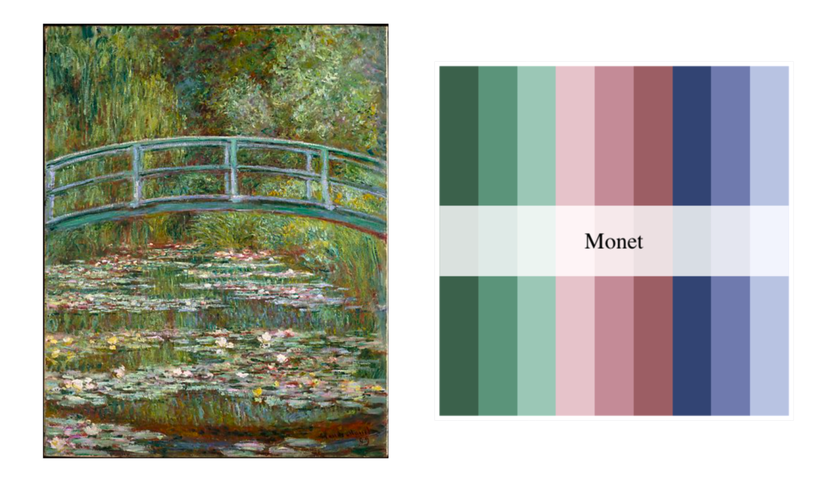
:::

:::{.column}
```{r}
library(MetBrewer)

staff_long |>
  ggplot(aes(x = position, y = percentage, fill = position)) +
  geom_col() +
  scale_fill_manual(values = met.brewer("Monet"))
```
:::
:::

## {ggplot2} palette packages
<hr>
::: {.smaller-font}
Let's try the [Egypt](https://github.com/BlakeRMills/MetBrewer?tab=readme-ov-file#egypt) palette:
:::

::: {layout="[1,3]"}
:::{.column}
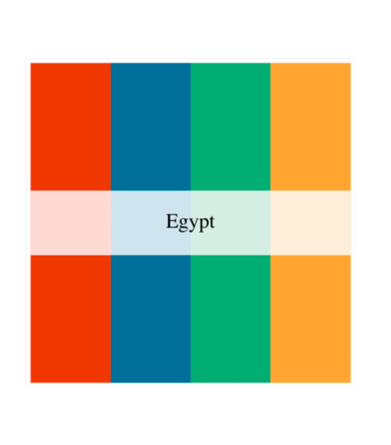
:::

:::{.column}
```{r}
#| eval: false
library(MetBrewer)

staff_long |>
  ggplot(aes(x = position, y = percentage, fill = position)) +
  geom_col() +
  scale_fill_manual(values = met.brewer("Egypt"))
```


. . .

```{r}
#| echo: false
#| error: true
library(MetBrewer)

staff_long |>
  ggplot(aes(x = position, y = percentage, fill = position)) +
  geom_col() +
  scale_fill_manual(values = met.brewer("Egypt"))
```

<br>
<br>
Why didn't this work?
:::
:::

## {ggplot2} palette packages
<hr>

::: {.smaller-font}
- [MetBrewer](https://github.com/BlakeRMills/MetBrewer) supports continuous palettes (gradients), too:
  - Problem: Not a smooth/perceptually uniform gradient

```{r}
#| code-line-numbers: "|7,11"
#| out-width: "50%"
library(MetBrewer)

staff_long |>
  ggplot(aes(
    x = as.integer(year),
    y = percentage,
    color = percentage,
    group = position
  )) +
  geom_line(linewidth = 2) +
  scale_color_gradientn(colors = met.brewer("Isfahan1"))
```

:::

# viridis

## viridis {.smaller}
<hr>
- viridis is one of the most popular palettes in ggplot and in data viz
- Built into {ggplot2}
- produces a smooth gradient: equal perceived steps in color (i.e., no big jumps between colors)

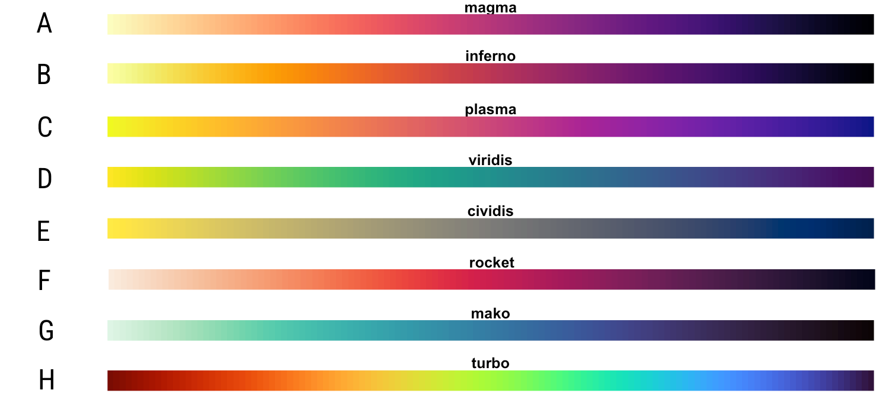{fig-align="center" width="60%"}

::: aside
Christiansen, J. (2022). Building science graphics: An illustrated guide to communicating science through diagrams and visualizations. CRC Press. [Ch. 8]
:::

## viridis {.smaller}
<hr>

- How to use built-in viridis in your {ggplot2} code:
  - Know your mapping variable (discrete or continuous?)
  - Know your aesthetic (fill or color?)

```{r echo=F}
library(gt)

data <- tibble::tribble(
  ~label                              , ~"Discrete Variable" , ~"Continuous Variable" ,
  "Fill<br><i>(Background Color)</i>" ,
  "`scale_fill_viridis_d()`"          ,
  "`scale_fill_viridis_c()`"          ,
  "Color<br><i>(Outline Color)</i>"   ,
  "`scale_color_viridis_d()`"         ,
  "`scale_color_viridis_c()`"
)

data |>
  gt() |>
  fmt_markdown(columns = everything()) |>
  tab_style(
    style = cell_text(weight = "bold"),
    locations = cells_column_labels(everything())
  ) |>
  tab_options(
    table.font.names = "Arial",
    table.font.size = pct(110),
    table.align = "center",
    data_row.padding = px(6),
    column_labels.border.top.width = px(1),
    column_labels.border.bottom.width = px(1),
    table.border.top.width = px(1)
  )
```
## viridis {.smaller}
<hr>

::: {.smaller-font .tight-lines}
- The default color option is viridis itself (Option D).
- *Note*: I am mapping color to `percentage`, a continuous variable.

```{r}
#| code-line-numbers: "|5,9"
#| out-width: "60%"
staff_long |>
  ggplot(aes(
    x = as.integer(year),
    y = percentage,
    color = percentage,
    group = position
  )) +
  geom_line(linewidth = 2) +
  scale_color_viridis_c()
```
:::

## viridis {.smaller}
<hr>
You can specify other options for viridis, too!

:::{layout="[1,2]" .smaller-font}

:::{.column}
{fig-align="center"}
:::

:::{.column .extra-small-font}

```{r}
staff_long |>
  ggplot(aes(
    x = as.integer(year),
    y = percentage,
    color = percentage,
    group = position
  )) +
  geom_line(linewidth = 2) +
  scale_color_viridis_c(option = "A")
```
:::
:::

## viridis {.smaller}
<hr>
How about with our bar chart?

```{r}
#| eval: false
staff_long |>
  ggplot(aes(x = position, y = percentage, fill = position)) +
  geom_col() +
  scale_fill_viridis_c()
```

## viridis {.smaller}
<hr>
How about with our bar chart?

```{r}
#| error: true
staff_long |>
  ggplot(aes(x = position, y = percentage, fill = position)) +
  geom_col() +
  scale_fill_viridis_c()
```

<br>

Why didn't it work?

## viridis {.smaller}
<hr>
We were trying to use the function for a **continuous** palette and our mapped variable (`position`) is **discrete**.

```{r}
#| code-line-numbers: "|4"
staff_long |>
  ggplot(aes(x = position, y = percentage, fill = position)) +
  geom_col() +
  scale_fill_viridis_d(option = "G")
```

<!-- 
## viridis  {.smaller}
<hr>
How would you use viridis on our line graph where `color = position`?

```{r}
staff_long |>
  ggplot(aes(x = year, y = percentage, color = position)) +
  geom_line(linewidth = 2)
```

## viridis  {.smaller}
<hr>
How would you use viridis on our line graph where `color = position`? Answer: `scale_color_viridis_d()`.

```{r}
#| code-line-numbers: "4"
staff_long |>
  ggplot(aes(x = year, y = percentage, color = position)) +
  geom_line(linewidth = 2) +
  scale_color_viridis_d()
```
 -->


<!-- ## Checklist of tips {.smaller}
<hr>
* Make sure to map to the data appropriately in `aes()` if you are mapping to data; otherwise, it will map to geometry
* Make sure your `color` or `fill` match, i.e., you are not trying to apply `color` to a `fill` aesthetic
* Make sure that if you are using a discrete palette, you have enough values
* Make sure that you are not trying to apply a continuous palette to discrete values -->

<!-- ## Finding palette packages {.smaller}
<hr>

:::{.smaller-font}
- Wouldn't it be great if these palettes were contained in one package?
  - {paletteer} has *most* of them easily in one package (not all)
  - You still have to install the package with the palette you want, but you can access them all in the same way (with the same syntax) in {paleteer}
- Once installed, {paleteer} works a lot like {ggplot2}'s built-in viridis
:::

```{r echo=F}
library(gt)

data2 <- tibble::tribble(
  ~label                              , ~"Discrete Variable" , ~"Continuous Variable" ,
  "Fill<br><i>(Background Color)</i>" ,
  "`scale_fill_paletteer_d()`"        ,
  "`scale_fill_paletteer_c()`"        ,
  "Color<br><i>(Outline Color)</i>"   ,
  "`scale_color_paletteer_d()`"       ,
  "`scale_color_paletteer_c()`"
)

data2 |>
  gt() |>
  fmt_markdown(columns = everything()) |>
  tab_style(
    style = cell_text(weight = "bold"),
    locations = cells_column_labels(everything())
  ) |>
  tab_options(
    table.font.names = "Arial",
    table.align = "center",
    data_row.padding = px(6),
    column_labels.border.top.width = px(1),
    column_labels.border.bottom.width = px(1),
    table.border.top.width = px(1)
  )
```
:::{.smaller-font}
- The main difference is that {paletteer} uses the **"package_name::palette_name"** of the palette instead of the `option="D"` syntax

- Find the **"package_name::palette_name"** you want on the [{paletteer} website](https://r-graph-gallery.com/color-palette-finder)
  - They also print with `paletteer::palettes_c_names` and `paletteer::palettes_d_names`
:::

## Finding palette packages {.smaller}
<hr>

```{r}
#| code-line-numbers: "|1,2,7"
#install.packages("nationalparkcolors")
library(paletteer)

staff_long |>
  ggplot(aes(x = year, y = percentage, color = position)) +
  geom_line(linewidth = 2) +
  scale_color_paletteer_d("nationalparkcolors::Acadia")
```

## Finding palette packages {.smaller}
<hr>

```{r}
#| code-line-numbers: "1,2,7"
#install.packages("pals")
library(paletteer)

staff_long |>
  ggplot(aes(x = year, y = percentage, color = percentage, group = position)) +
  geom_line(linewidth = 2) +
  scale_color_paletteer_c("pals::ocean.haline")
```

## BONUS: {unicol} {.smaller}
<hr>
- [{unicol}](https://hneth.github.io/unicol/) has color palettes for different universities
- It [does not have one for UTK](https://hneth.github.io/unicol/articles/color_pals.html)
- But they do provide [instructions to contribute one at the bottom of the page](https://hneth.github.io/unicol/) -->


# Accessibility

## Colors {.smaller}
<hr>

:::{.smaller-font .tight-lines}
* Some people can distinguish fewer colors than others.
* {colorblindr} simulates different types of color blindness:

```{r}
#| out-width: "80%"
#remotes::install_github("clauswilke/colorblindr")
library(colorblindr)

#Using our plot `p`
cvd_grid(p)
```

:::

## Colors {.smaller}
<hr>
Some color palettes also consider accessibility:

* {viridis} is designed to be perceptually uniform (visually consistent change in color + accessible)
* {RColorBrewer} has colorblind-friendly palettes
* [{MetBrewer}](https://github.com/BlakeRMills/MetBrewer) has colorblind-friendly palettes
* {Paletteer}'s [website](https://r-graph-gallery.com/color-palette-finder) help you visualize palettes to approximate effects of colorblindness
* Accessible Custom Color Palette Generator: [https://venngage.com/tools/accessible-color-palette-generator](https://venngage.com/tools/accessible-color-palette-generator)

# Collaborative Practice

## Collaborative Practice
<hr>
- Launch into breakout rooms.
- Cameras off: 3-5 min to review task
- Cameras on: collaborative task work

# Looking Ahead

## Looking Ahead
<hr>

::: {.smaller-font}
- Reading:
    - Schwabish (2021), Ch 2
    - Christiansen (2023), Ch 9
    - France (2020)
- Comment on Mini Project #1 Plot Gallery
  - Something you learned/liked! Celebrate each others' work!
- Assignment 8: Graphing and Improving Plots
:::

**Mini-Project #2:** Assigned Next Week

## Finding palette packages {.smaller}
<hr>
* [{MetBrewer}](https://github.com/BlakeRMills/MetBrewer)
* [{wesanderson}](https://github.com/karthik/wesanderson)
* [{ggsci}](https://nanx.me/ggsci/)

- This is a fantastic resource: <https://github.com/EmilHvitfeldt/r-color-palettes>
- As is this: <https://github.com/erikgahner/awesome-ggplot2?tab=readme-ov-file#themes-and-aesthetics>

## Attribution for some materials used today {.smaller}
<hr>
* Data Science in a Box by Mine Çetinkaya-Rundel
* <https://datasciencebox.org/>
* License: [Creative Commons Attribution-ShareAlike 4.0 International](https://datasciencebox.org/license)