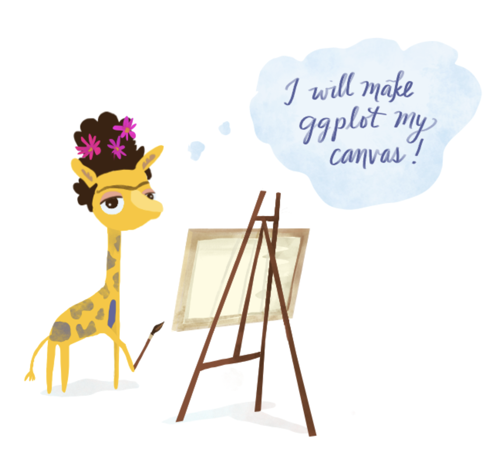
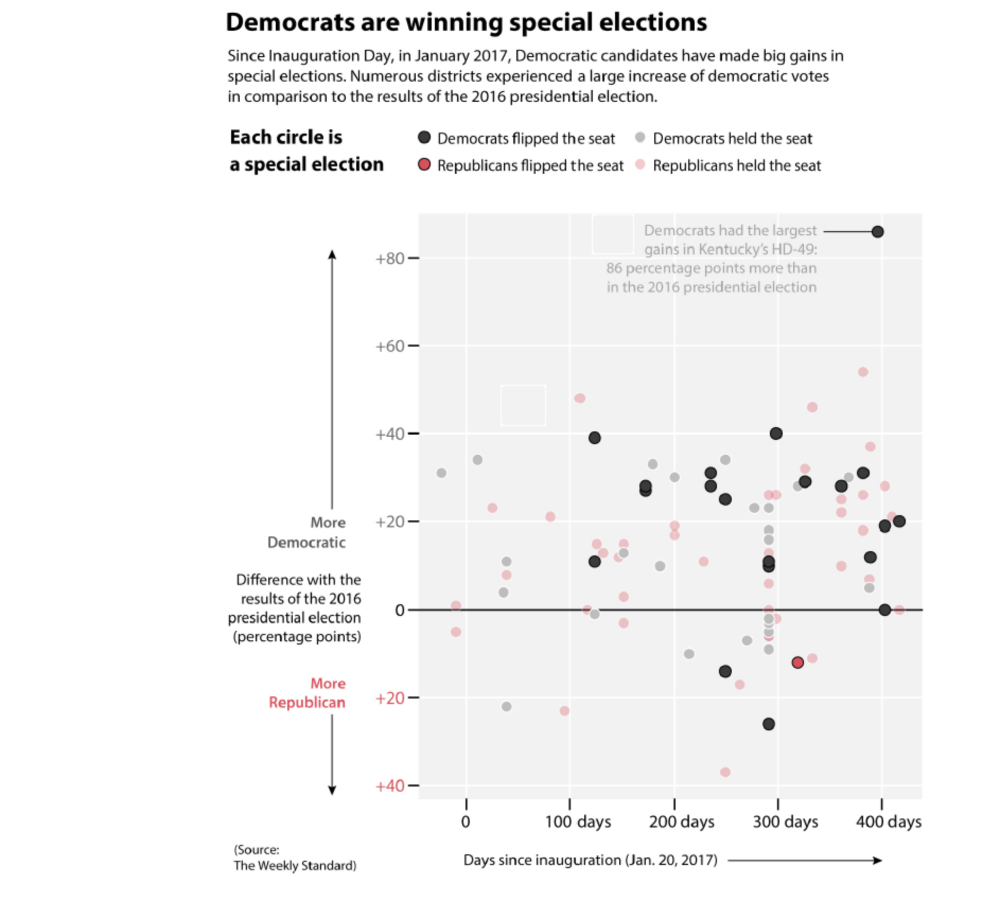
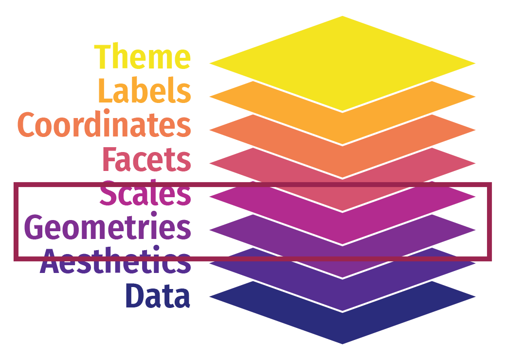
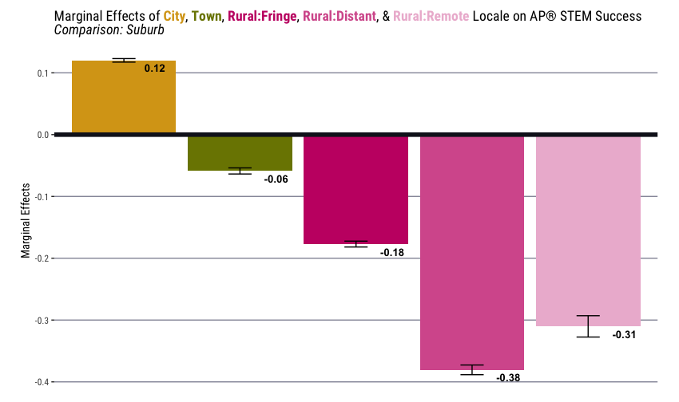

```{r, echo=F}
library(tidyverse)
library(tidykids)
```

# Weekly Check In/ <br>Download `.zip`

# Start Recording

## Today's Agenda
<hr>

:::{.smaller-font}
- Weekly Check In
- Review / Foundational Skills
  <!-- - "squished plots"
  - plotly -->
  - Mini Project #1
  - `pivot_longer()`
- Basic Principles
- `theme()` + text
- `scale_*_*`
- Text `geom_*()`s
- Fonts
- Collaborative Practice
- Mini-Project #2
- Looking Ahead
:::

## Norms
<hr>

:::{.compact-font}
| In person norms | And also, for online learning... |
|----------|----------|
| Be fully present to each other & the work. | Keep your video on when possible. In large groups, mute your microphone when not talking. Close/mute/minimize other apps and devices to avoid distraction. |
| Assume positive intent & also take responsibility for the impact you have. | Remember online interaction masks even more of the full story. Notice when you are making assumptions, and seek information to check them. |
| Embrace collaboration. | Use the gallery view so you can see everyone. Use breakout groups as an opportunity to collaborate. |
| Be open to learning and accept non-closure. | Expect the inevitable technical glitches and learning curves. Exercise patience with one another. |
| Be aware of when to step up and step back. When stepping back, do so as an active listener. | Try out different modes of participation. Step back by making space for others to engage in these. |
| Land your plane--get to the point you intended. | We all know how hard it is to be talked at, especially in a Zoom session, so let's keep it to a minimum. |

:::

# Review / Foundational Skills

# Mini Project #1

## Mini Project #1
<hr>
- Great work!
- Lots of really nice plots
- Some notes:
  - Excercise care in cleaning
  - When showing amounts, also show variability!
  - Clarity in answering your research question is key


<!-- ## `case_when()`{.smallest}
<hr>
::::::{.extra-small-font}
- We've used `case_when()` (with `mutate()`) quite a bit before, but it can do even more!

```{r, echo=FALSE}
toy <- as_tibble(as.integer(c("1", "2", NA)))
colnames(toy) <- "x"

toy
```

:::{layout=[1,1]}
::::{column}
Simple Case
```{r}
toy |>
  mutate(
    y = case_when(
      x == 1 ~ "one",
      x == 2 ~ "two"
    )
  )
```


::::
::::{column}


::::
:::
::::::

## `case_when()`{.smallest}
<hr>
::::::{.extra-small-font}
- We've used `case_when()` (with `mutate()`) quite a bit before, but it can do even more!

```{r, echo=FALSE}
toy <- as_tibble(as.integer(c("1", "2", NA)))
colnames(toy) <- "x"

toy
```

:::{layout=[1,1]}
::::{column}
Simple Case
```{r}
toy |>
  mutate(
    y = case_when(
      x == 1 ~ "one",
      x == 2 ~ "two"
    )
  )
```


::::
::::{column}
Simple Case + Re-use Variable
```{r}
toy |>
  mutate(
    y = case_when(
      x == 1 ~ 0,
      .default = x
    )
  )
```


::::
:::
::::::

## `case_when()`{.smallest}
<hr>
::::::{.extra-small-font}
- We've used `case_when()` (with `mutate()`) quite a bit before, but it can do even more!

```{r, echo=FALSE}
toy <- as_tibble(as.integer(c("1", "2", NA)))
colnames(toy) <- "x"

toy
```

:::{layout=[1,1]}
::::{column}
Simple Case
```{r}
toy |>
  mutate(
    y = case_when(
      x == 1 ~ "one",
      x == 2 ~ "two"
    )
  )
```

Simple Case + Catch All (Note: NAs)
```{r}
toy |>
  mutate(
    y = case_when(
      x == 1 ~ "one",
      .default = "not one"
    )
  )
```
::::
::::{column}
Simple Case + Re-use Variable
```{r}
toy |>
  mutate(
    y = case_when(
      x == 1 ~ 0,
      .default = x
    )
  )
```


::::
:::
::::::

## `case_when()`{.smallest}
<hr>
::::::{.extra-small-font}
- We've used `case_when()` (with `mutate()`) quite a bit before, but it can do even more!

```{r, echo=FALSE}
toy <- as_tibble(as.integer(c("1", "2", NA)))
colnames(toy) <- "x"

toy
```

:::{layout=[1,1]}
::::{column}
Simple Case
```{r}
toy |>
  mutate(
    y = case_when(
      x == 1 ~ "one",
      x == 2 ~ "two"
    )
  )
```

Simple Case + Catch All (Note: NAs)
```{r}
toy |>
  mutate(
    y = case_when(
      x == 1 ~ "one",
      .default = "not one"
    )
  )
```
::::
::::{column}
Simple Case + Re-use Variable
```{r}
toy |>
  mutate(
    y = case_when(
      x == 1 ~ 0,
      .default = x
    )
  )
```

Simple Case + Catch All + Preserve NAs
```{r}
toy |>
  mutate(
    y = case_when(
      x == 1 ~ "one",
      is.na(x) ~ NA,
      .default = "not one"
    )
  )
```
::::
:::
:::::: -->

::::{.fragment .extra-small-font}
```{r, echo=F}
library(knitr) #ignore this -> just doing it for the kable to print all cols
library(dsbox)
instructors <- instructors #in dsbox, assigning so it shows in environment
#kable(instructors)
```
::::

# tidy data + `pivot_longer()`

## tidy data
<hr>

#### Requirements for tidy data

::: {.smaller-font}
1. Each variable forms a column
2. Each observation forms a row
3. Each value forms a cell (1 cell: 1 value) and not spread across mult. columns

    - If you can split it, split it!

        - City, State
        - ACT/SAT
        - 26 inches (value + unit)
:::

## tidy data
<hr>

```{=html}
<style>
  .tidy-toggle { font-size: 0.5em; line-height: 1.4; text-align: left; }
  .tidy-toggle .tt-row { display: flex; flex-wrap: wrap; align-items: center; gap: 8px; margin-bottom: 10px; }
  .tidy-toggle .tt-label { opacity: 0.7; margin-right: 6px; }
  .tidy-toggle button {
    font: inherit; color: inherit; background: transparent; cursor: pointer;
    border: 1px solid rgba(128,128,128,0.5); border-radius: 6px; padding: 4px 12px;
  }
  .tidy-toggle button:hover { background: rgba(128,128,128,0.15); }
  .tidy-toggle button.on { background: rgba(128,128,128,0.25); border-color: rgba(128,128,128,0.9); font-weight: 600; }
  .reveal .tidy-toggle table { width: 100%; margin: 0 0 12px 0; border-collapse: collapse; table-layout: fixed; }
  .reveal .tidy-toggle table th,
  .reveal .tidy-toggle table td {
    padding: 6px 10px; text-align: left; font-family: monospace;
    border: 1px solid rgba(128,128,128,0.45); transition: background 0.15s;
  }
  .reveal .tidy-toggle table th { font-weight: 600; background: rgba(128,128,128,0.12); }
  .tidy-toggle .h1 { background: rgba(55,138,221,0.35) !important; }
  .tidy-toggle .h2 { background: rgba(239,159,39,0.40) !important; }
  .tidy-toggle .h3 { background: rgba(99,153,34,0.40)  !important; }
  .tidy-toggle .tt-cap {
    display: flex; gap: 10px; align-items: flex-start; padding: 10px 14px;
    border-radius: 6px; background: rgba(128,128,128,0.12); min-height: 3.2em;
  }
  .tidy-toggle .tt-icon { font-weight: 700; font-size: 1.3em; line-height: 1; }
  .tidy-toggle .tt-icon.bad  { color: #d9534f; }
  .tidy-toggle .tt-icon.good { color: #3c9a3c; }
</style>

<div class="tidy-toggle">
  <div class="tt-row">
    <span class="tt-label">Table</span>
    <button data-mode="wide">Wide</button>
    <button data-mode="long">Long</button>
  </div>
  <div class="tt-row">
    <span class="tt-label">Check rule</span>
    <button data-rule="1">1 · Variables are columns</button>
    <button data-rule="2">2 · Observations are rows</button>
    <button data-rule="3">3 · Values are cells</button>
  </div>
  <div class="tt-table"></div>
  <div class="tt-cap"><span class="tt-icon"></span><span class="tt-text"></span></div>
</div>

<script>
(function () {
  var years = [1975, 1989];
  var pos = ['full_time_tenured', 'part_time', 'grad_student'];
  var vals = { 1975: [29.0, 24.0, 20.5], 1989: [27.6, 30.4, 16.5] };

  var caps = {
    wide: {
      1: [false, 'The column names full_time_tenured, part_time, and grad_student are values of one variable (position). Position is a variable, but it has no column of its own.'],
      2: [false, 'This one row holds three observations: tenured, part-time, and grad students, all in 1975. Each observation should get its own row.'],
      3: [false, 'Percentage is a single variable, but its values are spread across three columns instead of living in one.']
    },
    long: {
      1: [true, 'Three variables, three columns: year, position, and percentage.'],
      2: [true, 'One row, one observation: the share of part-time instructors in 1975. The next row is a different observation.'],
      3: [true, 'Every percentage sits in a single column, one value per cell.']
    }
  };

  function cell(tag, txt, cls) {
    return '<' + tag + (cls ? ' class="' + cls + '"' : '') + '>' + txt + '</' + tag + '>';
  }

  function init(root) {
    var mode = 'wide', rule = null;

    function render() {
      var T = 'ta' + 'ble';
      var c = rule ? 'h' + rule : '', h = '<' + T + '>';

      if (mode === 'wide') {
        h += '<tr>' + cell('th', 'year', '');
        pos.forEach(function (p) { h += cell('th', p, rule === 1 ? c : ''); });
        h += '</tr>';
        years.forEach(function (y, i) {
          var rowOn = rule === 2 && i === 0;
          h += '<tr>' + cell('td', y, rowOn ? c : '');
          vals[y].forEach(function (v) {
            h += cell('td', v.toFixed(1), (rowOn || rule === 3) ? c : '');
          });
          h += '</tr>';
        });
      } else {
        h += '<tr>';
        ['year', 'position', 'percentage'].forEach(function (t) {
          h += cell('th', t, rule === 1 ? c : '');
        });
        h += '</tr>';
        var n = 0;
        years.forEach(function (y) {
          pos.forEach(function (p, j) {
            var rowOn = rule === 2 && n === 1;
            h += '<tr>' + cell('td', y, rowOn ? c : '') +
                 cell('td', p, rowOn ? c : '') +
                 cell('td', vals[y][j].toFixed(1), (rowOn || rule === 3) ? c : '') + '</tr>';
            n++;
          });
        });
      }
      h += '</' + T + '>';
      root.querySelector('.tt-table').innerHTML = h;

      var icon = root.querySelector('.tt-icon');
      if (rule === null) {
        icon.textContent = '';
        icon.className = 'tt-icon';
        root.querySelector('.tt-text').textContent = '';
      } else {
        var cp = caps[mode][rule];
        icon.textContent = cp[0] ? '\u2713' : '\u2717';
        icon.className = 'tt-icon ' + (cp[0] ? 'good' : 'bad');
        root.querySelector('.tt-text').textContent = cp[1];
      }

      root.querySelectorAll('[data-mode]').forEach(function (b) {
        b.classList.toggle('on', b.dataset.mode === mode);
      });
      root.querySelectorAll('[data-rule]').forEach(function (b) {
        b.classList.toggle('on', Number(b.dataset.rule) === rule);
      });
    }

    root.querySelectorAll('[data-mode]').forEach(function (b) {
      b.addEventListener('click', function () { mode = b.dataset.mode; render(); });
    });
    root.querySelectorAll('[data-rule]').forEach(function (b) {
      b.addEventListener('click', function () {
        var n = Number(b.dataset.rule);
        rule = (rule === n) ? null : n;   // click again to deselect
        render();
      });
    });
    render();
  }

  document.querySelectorAll('.tidy-toggle').forEach(init);
})();
</script>
```

:::{.extra-small-font}
Wickham, H. (2014). Tidy data. Journal of Statistical Software, 59(10), 1-23. https://doi.org/10.18637/jss.v059.i10
:::


# tidying the data

## `pivot_longer` {.smaller}
<hr>

- Long data (tidy data) is often preferred, esp. in {tidyverse}
- `pivot_longer()` is your friend
  - See documentation [here](https://tidyr.tidyverse.org/reference/pivot_longer.html)
  - Inverse operation of `pivot_wider()`

## `pivot_wider` (recap) {.smaller}
<hr>
- Recently:


:::{.extra-small-font}
Batra, Neal, et al. (2021). *The Epidemiologist R Handbook*. www.epirhandbook.com/en/
:::

## `pivot_longer` {.smaller}
<hr>

- Long data (tidy data) is often preferred, esp. in {tidyverse}
- `pivot_longer()` is your friend
  - See documentation [here](https://tidyr.tidyverse.org/reference/pivot_longer.html)
  - Inverse operation of `pivot_wider()`


:::{.extra-small-font}
Batra, Neal, et al. (2021). *The Epidemiologist R Handbook*. www.epirhandbook.com/en/
:::


## tidy data & `pivot_longer`
<hr>

:::{.smaller-font .tight-lines}
**Requirements for tidy data:**

1. Each variable forms a column
2. Each observation forms a row
3. Each value forms a cell
:::

::: {.fragment .smaller-font}
```{r}
head(instructors, 5)
```

::::{.fragment}
`pivot_longer()`
::::
:::

::::{.fragment .smaller-font}
```{r, eval=F}
staff_long <- instructors |>
  pivot_longer(
    cols = -year, # "Which columns do I pivot?"
    names_to = "position", # "What should I call the new column that holds the old column names?"
    values_to = "percentage" # "What should I call the new column that holds the old values?"
  )
```
::::


## tidy data & `pivot_longer`
<hr>

:::{.smaller-font .tight-lines}
**Requirements for tidy data:**

1. Each variable forms a column
2. Each observation forms a row
3. Each value forms a cell

::::{.fragment}

`pivot_longer()`
:::
::::

::::{.fragment .smaller-font}
```{r}
staff_long <- instructors |>
  pivot_longer(
    cols = -year, # "Which columns do I pivot?"
    names_to = "position", # "What should I call the new column that holds the old column names?"
    values_to = "percentage" # "What should I call the new column that holds the old values?"
  )
head(staff_long, 10)
```
::::


 

# Recap & Continuing Today...

## {ggplot2} is our canvas
<hr>
{fig-align="center" width=500px}

::: aside
Art by [Desirée De Leon](http://desiree.rbind.io/), [CC-BY-NC-ND](https://tinystats.github.io/teacups-giraffes-and-statistics/)
:::

## Text and Visualization
<hr>
> “Make words and visuals work together effectively — not just showing the data, but explaining the data; helping readers become more visually literate, and reinforcing the main messages the graphic is displaying.”

--- Alberto Cairo

## Text and Visualization
<hr>
:::: columns

::: {.column width="35%" .smaller-font}

Cairo uses this example of a "rich" plot in his book *How Charts Lie*:

- There is a title and a subtitle
- There is a easy to understand legend
- There are defined x- and y-axes
- There is an annotation
- There is a caption
- All text is horizontal (the way we naturally read)

:::

::: {.column width="65%"}

{width=500px}
:::

::::

<!-- ## Using Christiansen and France {.smaller}
<hr>
- Christiansen, Ch. 9 (2023) and France (2020) provide several suggestions for typographic choices for visualizing data
- In groups, we will choose ONE style guide and compare it to Christiansen and France
  - Find your group document on Canvas
  - Choose your style guide from the list
  - Review it
  - Compare its components to Christiansen and France
  - If you have enough time, compare the guide you chose to another from the list

- *Choose a spokesperson to report back!*
<br>**BREAKOUT ROOMS (10-15 min)**
-->
 

## AAUP Data Today {.smaller}
<hr>
- Same data as last week

:::{.smaller-font}
```{r}
staff_long
```
:::

## Creating a Plot - Column Chart
<hr>
```{r}
p <- staff_long |>
  filter(year == 2011) |>
  ggplot(aes(x = position, y = percentage, fill = position)) +
  geom_col()

p
```

## Creating a Plot - Custom Palette
<hr>
:::{.smaller-font}
```{r}
library(MetBrewer)

# Chose to reverse the direction of palette as per documentation
p <- p + scale_fill_manual(values = met.brewer("Hokusai1", direction = -1))

p
```
:::

## Creating a Plot - Adding Some Text
<hr>
:::{.smaller-font}
```{r}
#| fig-height: 4.5
p <- p +
  labs(
    title = "Instructional Staff Employment Proportions in 2011",
    caption = "Source: American Association of University Professors (AAUP)",
    y = "Percentage",
    fill = "Position"
  )

p
```
:::

# Themes + text

## Recap: Themes in {ggplot2} anatomy
<hr>
{fig-align="center"}

## What does `theme()` allow us to edit?
<hr>
The 'theme' involves editing the content that supports the data but does not deliver the quantitative information itself: "data ink".

- Text

. . .

- Rectangles

. . .

- Lines

. . .

- Draw nothing

## `theme()` allows us to edit data ink {.smaller}
<hr>
- Includes text

```{r}
#| code-line-numbers: "|3|4|5|6"
p <- p +
  theme(
    panel.grid = element_blank(), #remove lines
    panel.background = element_blank(), #remove rectangles
    axis.title.x = element_blank(), #remove text
    #legend.position = "none" #odd one - take note
  )

p
```

## `theme()` lets us edit text elements {.smaller}
<hr>

- `element_text()` sets the font size, colour and face of text elements like `plot.title`.
- You can control the font `family`, `face`, `colour`, `size` (in points), `hjust`, `vjust`, `angle` (in degrees) and `lineheight`.

```{r}
#| code-line-numbers: "|2"
p <- p +
  theme(axis.text.x = element_text(face = "bold", angle = 45, vjust = .5))
```

## `theme()` lets us edit text elements {.smaller}
<hr>

```{r}
#| code-line-numbers: "|2"
p
```

::: aside
More details on the parameters can be found in `vignette("ggplot2-specs")`.
:::

# scale_*_*

## scale_*_* functions
<hr>
- See the [{ggplot}](https://rstudio.github.io/cheatsheets/data-visualization.pdf) cheatsheet for a list of `scale_*_*` functions
- We've already used some of these last week to create custom palettes
- I think of these like a family of functions
  - Common set of core arguments

## Editing axes {.smaller}
<hr>
We can edit the start/end of axes using `scale_*_*`.

```{r}
#| code-line-numbers: "|2|3|4"
p <- p +
  scale_y_continuous(
    limits = c(0, 100),
    breaks = seq(0, 100, 20),
    labels = scales::label_percent(scale = 1)
  )

p
```

:::{.smaller-font}
- There are [other `label_*()` functions](https://scales.r-lib.org/reference/index.html) too
:::

## Editing axes {.smaller}
<hr>
We can also use `scale_*_*` to edit the labels on the axes.

```{r}
p <- p +
  scale_x_discrete(
    labels = c(
      "full_time_non_tenure_track" = "Full Time Non-Tenure Track",
      "full_time_tenure_track" = "Full Time Tenure Track",
      "full_time_tenured" = "Full Time Tenured",
      "grad_student" = "Grad Student",
      "part_time" = "Part Time"
    )
  )

p
```

## Editing axes {.smaller}
<hr>
We can also use `scale_*_*` to edit the labels in the legend.

:::{.smaller-font}
- We already used scale_fill_manual() to create a custom palette with {MetBrewer}, so I'm just adding the labels argument in to what we already had.
:::
  
```{r}
p <- p +
  scale_fill_manual(
    values = met.brewer("Hokusai1", direction = -1),
    labels = c(
      "full_time_non_tenure_track" = "Full Time Non-Tenure Track",
      "full_time_tenure_track" = "Full Time Tenure Track",
      "full_time_tenured" = "Full Time Tenured",
      "grad_student" = "Grad Student",
      "part_time" = "Part Time"
    )
  )
```

## Editing axes {.smaller}
<hr>
We can also use `scale_*_*` to edit the labels in the legend.

```{r}
p
```


## `theme()` allows us to edit data ink {.smaller}
<hr>
- Now I'll remove the legend 

```{r}
#| code-line-numbers: "|3"
p <- p +
  theme(
    legend.position = "none" #odd one - take note
  )

p
```

# Text `geom_*`s

## Recap: Geoms in {ggplot2} anatomy {.smaller}
<hr>
{fig-align="center"}

## What do geoms allow us to do?
<hr>
- **geoms**: Geometric objects like points, lines, bars
- And also, text!

```{r}
ggplot(mtcars, aes(wt, mpg, label = rownames(mtcars))) +
  geom_text()
```

## Text geoms {.smaller}
<hr>
Text geoms are useful for labeling plots. They can be used by themselves as scatterplots or in combination with other geoms, for example, for labeling points or for annotating the height of bars.

- `geom_text()` adds text to the plot
- `geom_label()` draws a rectangle behind the text
- `annotate()` adds labels at specified points

::: aside
{ggplot2} text documentation: <https://ggplot2.tidyverse.org/reference/geom_text.html>
:::

## `geom_text()` {.smaller}
<hr>
```{r}
#| code-line-numbers: "|1|2|3"
p +
  geom_text(
    aes(label = scales::label_percent(scale = 1)(percentage)),
    vjust = -0.5,
    size = 3.5
  )
```

## `geom_label()` {.smaller}
<hr>
```{r}
p +
  geom_label(
    aes(label = scales::label_percent(scale = 1)(percentage)),
    vjust = -0.5,
    size = 3.5
  )
```

## `annotate()` {.smaller}
<hr>
To add labels at specified points, use `annotate()` with `annotate(geom = "text", ...)` or `annotate(geom = "label", ...)`.

```{r}
#| eval: false
p +
  annotate(
    geom = "text",
    label = "Part-time faculty percentage has increased\nfrom x% in 1975 to x% in 2011.",
    x = 5.5,
    y = 60,
    size = 3,
    colour = "#C6473E",
    hjust = "right" #Can give number or specify left, right, center
  )
```
- This is when you want to hard code the numbers (e.g., x%) - not recommended

## `annotate()` {.smaller}
<hr>
What if instead of hard coding our numbers, we calculate it from our data?

```{r}
pt_pct_1975 <-
  staff_long |>
  filter(position == "part_time", year == "1975") |>
  pull(percentage)

pt_pct_1975

pt_pct_2011 <-
  staff_long |>
  filter(position == "part_time", year == "2011") |>
  pull(percentage)

pt_pct_2011
```

## `annotate()`{.smaller}
<hr>

:::{.smaller-font}
```{r}
#| code-line-numbers: "|9|10|11|12|13|14|15"
p <- p +
  geom_text(
    aes(label = scales::label_percent(scale = 1)(percentage)),
    vjust = -0.5,
    size = 3.5
  ) +
  annotate(
    geom = "text",
    label = paste0(
      "Part-time faculty percentage has increased\nfrom ",
      scales::label_percent(scale = 1)(pt_pct_1975),
      " in 1975 to ",
      scales::label_percent(scale = 1)(pt_pct_2011),
      " in 2011."
    ),
    x = 5.5,
    y = 60,
    size = 3,
    colour = "#C6473E",
    hjust = "right"
  )
```
:::

## `annotate()`
<hr>
```{r}
p
```

# {ggtext}

## {ggtext}{.smaller}
<hr>

```{r}
#| code-line-numbers: "|3-6|8-9|10-11,16|12|13-15|"
library(ggtext)

per_pt <-
  staff_long |>
  filter(year == 2011, position == "part_time") |>
  pull()

p <- p +
  labs(
    subtitle = paste0(
      "Part-timers made up <b><span style = 'color:#C6473E;'>",
      scales::label_percent(scale = 1)(per_pt),
      "</span></b> of faculty in 2011"
    )
  ) +
  theme(plot.subtitle = ggtext::element_markdown()) #Makes the html work!
```

## {ggtext}
<hr>
```{r}
p
```

## {ggtext}
<hr>
- Can also use {ggtext} to remove need for legend
{width=70%}

:::aside
Boles & Domingue (under review)
:::

## {ggtext}{.smaller}
<hr>

```r
labs(y = "Marginal Effects", title = "Marginal Effects of 
<b><span style = 'color: #D8A419;'>City</span></b>,
<b><span style = 'color: #7B8400;'>Town</span></b>,
<b><span style = 'color: #C61A72;'>Rural:Fringe</span></b>,
<b><span style = 'color: #D65E9B;'>Rural:Distant</span></b>, & 
<b><span style = 'color: #EDBAD4;'>Rural:Remote</span></b>
Locale on AP® STEM Success<br><i>Comparison: Suburb</i>")
```
{width=50%}

:::aside
Boles & Domingue (under review)
:::

# Fonts

## `family` aesthetic {.smaller}
<hr>
- The `family` aesthetic provides the name of a font. This aesthetic does allow you to use the name of a system font, but some care is required.
- There are only three fonts that are guaranteed to work everywhere: “sans” (the default), “serif”, or “mono”.

```{r}
#| code-line-numbers: "|2-3"
p <- p +
  theme(plot.title = element_text(size = 18, family = "serif"))
```

## `family` aesthetic {.smaller}
<hr>
```{r}
p
```

## Using other fonts {.smaller}
<hr>
Text drawing is handled differently by each graphics device (GD):

- `windows()` (for Windows)
- `quartz()` (for Macs)
- `x11()` (mostly for Linux)
- `RStudioGD()` within RStudio

The devices do not specify fonts in the same way, so if you want a font to work everywhere you need to configure the devices in different ways.

## Using other fonts {.smaller}
<hr>
Two packages simplify fonts a bit:

- **{showtext}**, [https://github.com/yixuan/showtext](https://github.com/yixuan/showtext), by Yixuan Qiu, makes GD-independent plots by rendering all text as polygons
- **{extrafont}**, [https://github.com/fbertran/extrafont](https://github.com/fbertran/extrafont), by Winston Chang, converts fonts to a standard format that all devices can use

## Using Google fonts with {showtext} {.smaller}
<hr>
- `font_add_google(name, family)` adds a font
  - `name` is the name of the font searched in [Google Fonts](https://fonts.google.com/)
  - `family` is the name you assign
- The `showtext_auto()` function tells R to render text using {showtext}

## Using Google fonts with {showtext} {.smaller}
<hr>
Changing `text` edits the font family for the plot fonts.

```{r}
#| code-line-numbers: "|3|4|5|7-8"
library(showtext)

font_add_google(name = "Open Sans", family = "open-sans")
showtext_opts(dpi = 300) #Helps fonts play nice with ggsave()
showtext_auto() #necessary for it to work

p <- p +
  theme(text = element_text(size = 9, family = "open-sans"))
```

::: {.callout-tip}
You may need to install additional packages for `font_add_google()`. On Windows, be prepared to install {jsonlite} and {curl}.
:::

## Using Google fonts with {showtext} {.smaller}
<hr>
- Why didn't the title change? Everything else worked...
```{r}
p
```

## Using Google fonts with {showtext} {.smaller}
<hr>
You can specify fonts for different plot elements, as well.

```{r}
#| code-line-numbers: "|1|4-5"
font_add_google(name = "Schoolbell", family = "bell")

p <- p +
  theme(plot.title = element_text(size = 18, family = "bell"))
# Note I could have specified "open-sans" here to fix the earlier issue.
```

## Using Google fonts with {showtext} {.smaller}
<hr>
```{r}
p
```

## Using custom fonts with {showtext} {.smaller}
<hr>
`font_add()` adds a font file like `.ttf`

- `family` is the family name of the font
- `regular` is the font file path

```{r}
#| code-line-numbers: "|1-2|5-6"
font_add(family = "Asenine", regular = ("ASENINE_.ttf"))

p <- p +
  theme(plot.title = element_text(size = 18, family = "Asenine"))
```

## Using custom fonts with {showtext} {.smaller}
<hr>
```{r}
p
```

## Other helpful packages for text {.smaller}
<hr>
- {ggrepel} - repel overlapping text labels
- {ggforce} - extends {ggplot2} in various ways
- {gghighlight} - direct labeling in {ggplot2}
- {ggfittext} - fit text into boxes
- {directlabels} - puts labels close to data

## Accessibility {.smaller}
<hr>
- Sufficient labels
- Do not rely on color alone
- Label significant parts of the graph
- Use labels and legends that clearly mark and distinguish the data points

# BREAK

## Collaborative Practice {.smaller}
<hr>
- You will do Steps 3-5.
    - 1,2, & 6 have been done for you.
- Launch into breakout rooms.
- Cameras off: 3-5 min to review task
- Cameras on: collaborative task work
- Individual option

# [Mini-Project #2](https://utk.instructure.com/courses/239375/assignments/2326753)

## Looking Ahead
<hr>
- Reading:
    - Chang (2024), Ch. 7
    - Chang (2024), Ch. 11
    - R Coder (2024)
- **Assignment:** Begin work on mini-project #2
- **Assignment:** Individually complete collaborative practice if not finished

<!-- ## Next Semester + Beyond
<hr>
- If you aren't registered already, please consider the [Educational Data Science Graduate Certificate](https://volsonline.utk.edu/programs-degrees/educational-data-science-gc/#courses).
- This class completes 25% of what you need.
- The capstone can be shaped around your interests/research. -->
